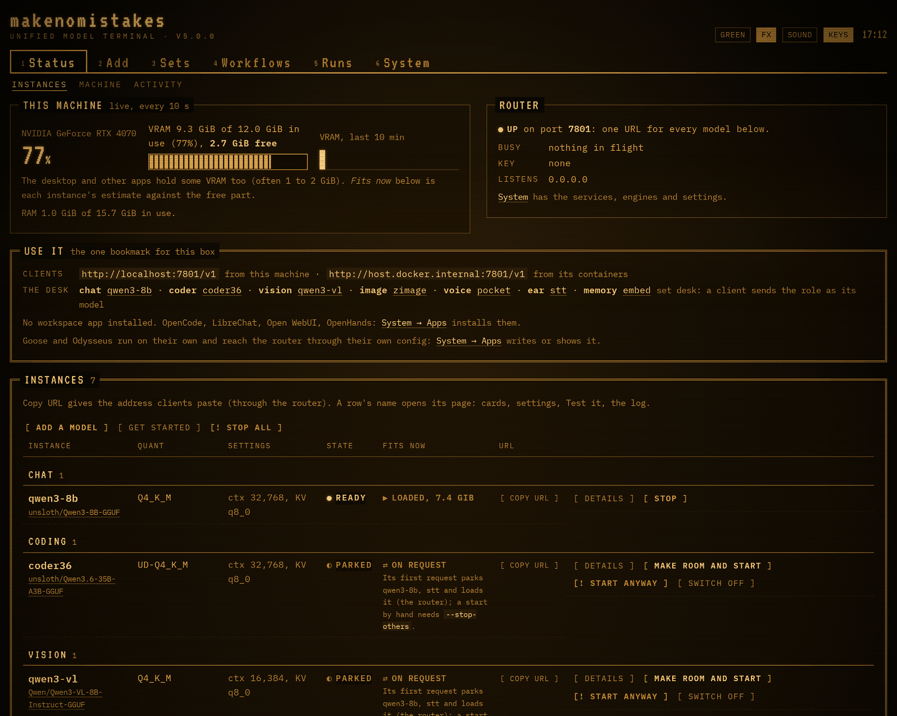
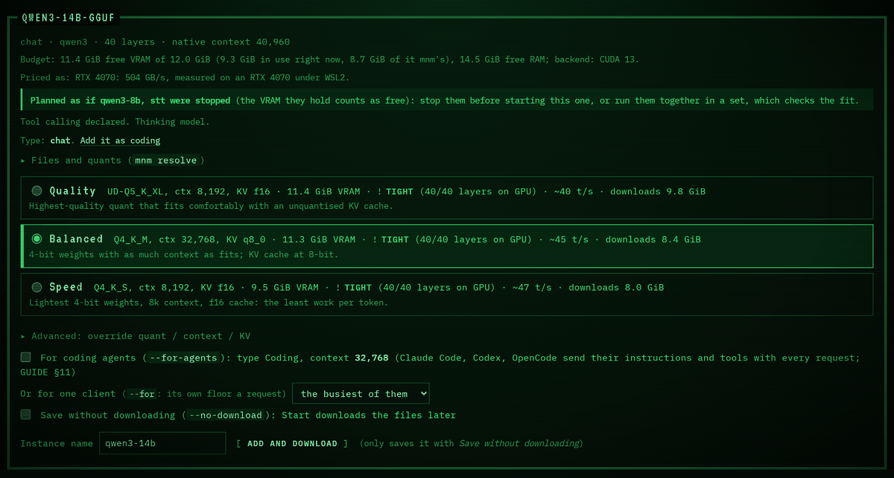
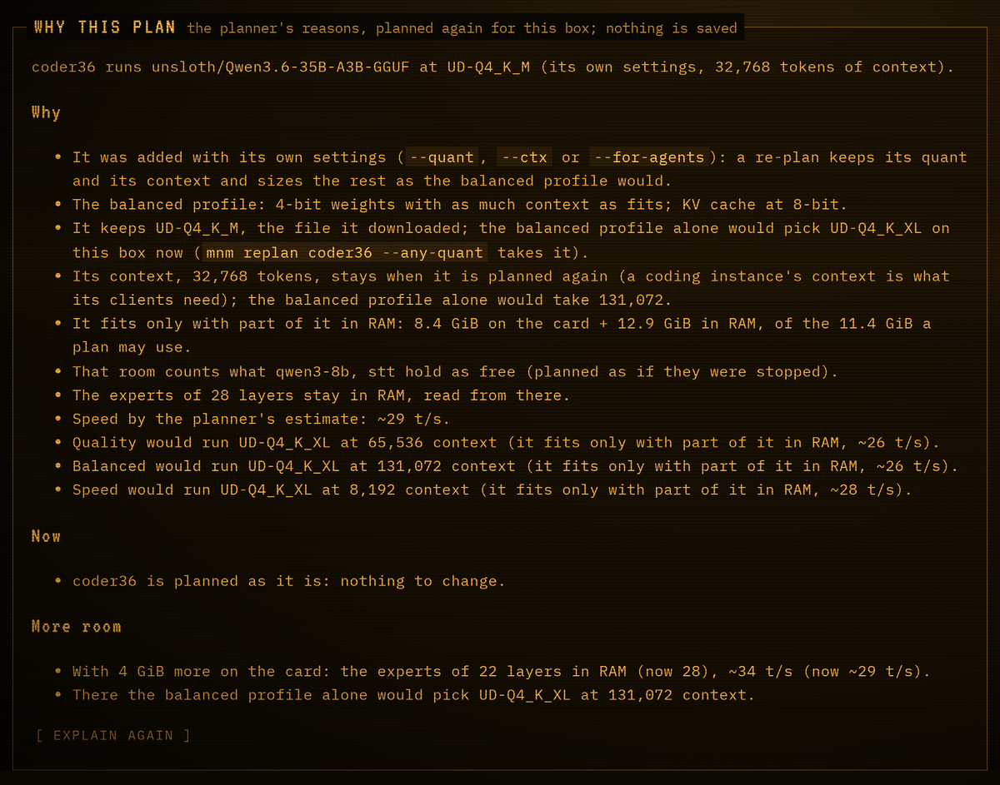
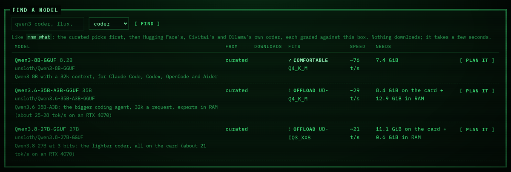
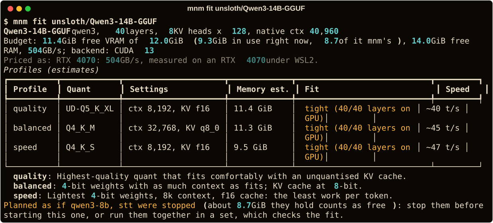

<p align="center">
  
</p>

<h1 align="center">make no mistakes</h1>

<p align="center">
  <b>Local AI models, planned for your machine, behind one URL.</b><br>
  Paste a Hugging Face link: <code>mnm</code> works out the quant, context and memory split that fit your card, runs the model in its engine's official Docker image, and serves every model at <code>http://localhost:7801/v1</code>.
</p>

<p align="center">
  <a href="#install">Install</a> ·
  <a href="#first-steps">First steps</a> ·
  <a href="#commands">Commands</a> ·
  <a href="#the-web-ui">Web UI</a> ·
  <a href="#connecting-apps">Apps</a> ·
  <a href="#faq">FAQ</a> ·
  <a href="docs/GUIDE.md">Guide</a>
</p>

<p align="center">
  <a href="LICENSE"></a>
  
  
  
  
</p>

<p align="center">
  
</p>

<table>
  <tr>
    <td width="33%"></td>
    <td width="33%"></td>
    <td width="33%"></td>
  </tr>
  <tr>
    <td align="center"><sub>Every plan is made against what the card and RAM have free</sub></td>
    <td align="center"><sub><code>mnm why</code> says why a plan is what it is</sub></td>
    <td align="center"><sub><code>mnm what</code> grades models before anything downloads</sub></td>
  </tr>
</table>

---

Running models locally is a stack of guesses: which quant fits the card, how much context, whether the KV cache should be 8-bit, which layers or experts go to RAM, which engine and which flags, and what happens when two models want the card at once. mnm makes those choices from measurements instead. It reads a model's header straight from the Hub before anything downloads, prices it against the VRAM and RAM your machine has free right now, and saves the plan as a recipe. The recipe runs the model in its engine's official Docker image, and one router serves every model at one address: it loads a model on the first request that needs it, unloads it when it sits idle, and parks others to make room when the card is full.

> **Status: 5.0.0.** The defaults are measured on an RTX 4070 (12 GB) under WSL2, where chat, coding agents, vision, embeddings, pictures, video and speech have all run through the router. Native Debian and Ubuntu, several cards, AMD, a DGX Spark, server boards and boxes without a card are planned from vendor figures and documentation, but not yet measured on real machines (ARM64 has run only under emulation); the planner corrects itself from each box's own readings. The studio's music models have so far run on the processor only. Bug reports are very welcome.

## Features

- **Planned, not guessed.** `mnm fit` reads a model's header remotely and shows three profiles (Quality, Balanced, Speed) with each one's memory, fit and speed; `mnm add` saves one and downloads it. Context, KV cache precision, layers on the card, a mixture-of-experts model's experts kept in RAM and the split across several cards are all decided from what is free at that moment. `mnm why` explains any plan in words.
- **One URL for every model.** The router speaks OpenAI's API (chat, completions, responses, embeddings, pictures, speech), Anthropic's messages and Ollama's API, so most apps work as they are. It loads models when a request needs them, unloads idle ones and makes room; pin a model or start a set of them together when you need them held.
- **Every kind of model.** Chat, coding, vision, embeddings and rerank on llama.cpp (vLLM for safetensors-only models); pictures, picture edits and video on stable-diffusion.cpp; speech-to-text on whisper.cpp; text-to-speech, songs, stems and voice conversion on audio.cpp. Optional ComfyUI for workflows from comfy.org, Civitai and Hugging Face, sandboxed with no internet.
- **Models from where they live.** Hugging Face, Civitai (and the Civitai Archive's copies of deleted models), Ollama's library, ModelScope and LM Studio links. A model mnm cannot run gets an explanation and the repos that run instead.
- **Official engines, updated when you say.** Each engine runs from its official image and nothing is compiled for it on your machine; `mnm engines update` tests a new build on a copy of your smallest model before keeping it, rolling back when it is slower or larger. The optional ComfyUI and the studio's tools are built on your machine from pinned sources, only when you ask for them.
- **It learns your box.** Every start and request is a reading that corrects later plans. `mnm tune` searches for faster settings while the card is idle; `mnm tune --quality` scores each quant against Q8_0 and keeps the most faithful one that is still fast enough.
- **Apps wired up.** OpenCode, LibreChat, Open WebUI and OpenHands installed and configured at pinned versions (`mnm apps install`); config files and cards for Claude Code, Codex, Goose, Aider, Cline, Zed, Continue, Home Assistant, n8n and more (`mnm url --for <app>`); an MCP server for chat apps that run tools.
- **A studio.** `mnm song new "a theme"` writes the lyrics, sings candidates, scores them for you to pick, splits the stems, cleans and re-voices the vocals, mixes, masters and exports a REAPER project with the stems.
- **Looks after itself.** A nightly check that flags slowdowns, a router that restarts an engine that crashed, scheduled backups, a disk policy that frees the least-used models, and notifications to your phone (ntfy) or Windows.
- **A web UI and a careful CLI.** A phosphor-terminal web UI with every command, and a CLI that checks before it installs and explains before it refuses.

## Requirements

| | |
|---|---|
| **System** | Windows 11 with WSL2 (Ubuntu 24.04), or Debian 12/13, Ubuntu 22.04/24.04 or a derivative of them, on x86-64 or ARM64 |
| **Graphics** | An NVIDIA card (a driver from the 580 series or newer), an AMD card (ROCm or Vulkan), or none: the processor runs the models, slowly |
| **Memory** | 16 GB of RAM or more; large mixture-of-experts models want more, and mnm says how much |
| **Disk** | Room for models: about 5 GB for a first chat model, 100 GB for a full set |
| **Software** | Docker Engine and NVIDIA's container toolkit (the setup installs both), and uv for Python 3.12 (the installer installs it) |

Under WSL the Windows driver serves the card: never install a Linux GPU driver inside WSL. On a native box the setup offers your distro's packaged NVIDIA driver and asks first.

## Install

mnm runs on **Windows 11 through WSL2** or on **native Linux** (Debian 12/13, Ubuntu 22.04/24.04 or a derivative of them). Pick one:

| | Windows 11 (WSL2) | Native Linux |
|---|---|---|
| **Good for** | Keeping Windows and its apps: Windows' own NVIDIA driver serves the card | A box for models: all of its RAM, no Windows desktop holding VRAM, several cards, AMD cards |
| **Trade-offs** | WSL gets only the RAM you give it, and models larger than the card are expected to run slower than natively | Setup installs the NVIDIA driver (it asks first) and a reboot follows; with Secure Boot on, a one-time key enrollment |
| **Tested** | Measured on an RTX 4070 | Supported, not yet measured on real hardware |

### Windows 11 (WSL2)

1. **Install Ubuntu.** In PowerShell:

   ```powershell
   wsl --install -d Ubuntu-24.04
   ```

   Restart if Windows asks, then open **Ubuntu** from the Start menu and choose a username and password. Your usual NVIDIA driver (580 or newer) serves the card inside WSL: install no other driver.

2. **Give WSL its memory.** WSL gets half the PC's RAM unless its settings file says otherwise. Open that file in PowerShell; Notepad offers to create it, at `C:\Users\<you>\.wslconfig`:

   ```powershell
   notepad "$env:USERPROFILE\.wslconfig"
   ```

   Write the lines for your PC's RAM, for example on a 32 GB PC:

   ```ini
   [wsl2]
   memory=24GB
   swap=8GB
   ```

   | PC's RAM | `memory=` | `swap=` |
   |---|---|---|
   | 16 GB | `16GB` (all of it: mnm wants 16 GB, and WSL takes memory only as it uses it) | `8GB` |
   | 32 GB | `24GB` | `8GB` |
   | 64 GB | `56GB` | `8GB` |

   Any other size: the PC's RAM less 8 GB for Windows, and at least 16 GB. Save the file, run `wsl --shutdown` in PowerShell, and open Ubuntu again.

3. **Continue with [the installer](#then-on-either)** in the Ubuntu terminal.

### Native Linux

1. **Use** Debian 12/13, Ubuntu 22.04/24.04 or a derivative (Linux Mint, Pop!_OS…), on x86-64 or ARM64, with a user that can run `sudo`.
2. **No driver beforehand.** Setup offers your distribution's packaged NVIDIA driver, asks first, and says when to reboot; with Secure Boot on, enroll its key at the blue *MOK management* screen after the reboot ([guide §3](docs/GUIDE.md#3-native-debian-and-ubuntu)). AMD cards get what ROCm or Vulkan needs, and a box without a card runs models on the processor.
3. **Continue with [the installer](#then-on-either)** in a terminal.

### Then, on either

1. Run the installer. Press Enter at each question for the recommended answer.

   ```bash
   curl -fsSL https://raw.githubusercontent.com/SergeantCS2/make-no-mistakes/main/install.sh | bash
   ```

2. If it asks you to restart (it does after installing Docker or a driver): on Windows, run `wsl --shutdown` in PowerShell and open Ubuntu again; on Linux, reboot. Then run setup again: it finds what is in place and finishes with the background services and your first models.

   ```bash
   mnm setup
   ```

3. Check that everything is ready. Each line should say OK, or name its fix.

   ```bash
   mnm doctor
   ```

To update later: `mnm update`. To remove everything: `bash ~/makenomistakes/uninstall.sh` (add `--dry-run` first to see what would go). The [guide](docs/GUIDE.md#2-install) covers unattended installs and native Linux in detail.

## First steps

1. **Open the web UI** at **http://localhost:7800** (or run `mnm open`).
2. **Add a model.** Click **Get started** and **Add** a model picked for your card, or click **Add a model**, paste a Hugging Face link, click **Check fit**, choose a profile and click **Add and download**.
3. **Try it.** Click the model's name, open **Test it** and click **Send**.
4. **Use it in an app.** The model's **Connect** tab shows what to paste into each app. Every model answers at `http://localhost:7801/v1` under its name.

The same from the terminal:

```bash
mnm add unsloth/Qwen3-8B-GGUF           # plan it for this machine and download it (about 5 GB)
mnm try qwen3-8b                        # a first answer
mnm url qwen3-8b --for open-webui       # what to paste into an app
```

## Commands

<p align="center">
  
</p>

| Command | What it does |
|---|---|
| `mnm setup` | The guided setup; run it again to change an answer |
| `mnm doctor [--deep]` | Checks the card, Docker, the network and the disk, with a fix for each problem |
| `mnm status` | The whole box on one screen: health, models, the queue, the last nightly |
| `mnm what [words] [--for USE]` | Finds models and grades each against this machine; never downloads |
| `mnm fit <link>` | Reads a model's header and shows the Quality, Balanced and Speed profiles |
| `mnm add <link>` | Plans a model for this machine, saves its recipe and downloads it |
| `mnm starter [PICK…]` | The starter models that fit this card |
| `mnm ls` / `mnm show <name>` | Every model with its state and fit / one model's settings and files |
| `mnm start` / `stop` / `rm <name>` | Starts a model; switches it off (the router refuses it until `mnm start`; `stop --park` only unloads it); removes it (`rm --files` frees its downloads) |
| `mnm try <name> [--speed]` | Sends a model a test request and prints the answer (or the picture, clip or sound) |
| `mnm why <name>` | Explains a plan, and what more room would change |
| `mnm set <name> key=value…` | Changes a setting (context, KV cache, idle time, draft model…) for the next start |
| `mnm replan [--all]` | Plans saved models again for the machine as it is now |
| `mnm url <name> --for <app>` | The URL and the steps for an app (`--write` writes its config file) |
| `mnm sets …` | Sets of models with a role each, started together or taking turns |
| `mnm tune <name> [--quality]` | Searches for faster settings, or the most faithful quant, while the card is idle |
| `mnm run <name> "prompt"` / `mnm outputs` | Makes something and keeps it as a run; the gallery of runs |
| `mnm song new "theme"` | Makes a song, stage by stage, with review points |
| `mnm apps install <app>` | Installs and configures a workspace app at a pinned version |
| `mnm engines [update]` | The engine images: what each runs, and updates that test themselves |
| `mnm serve` / `mnm service install` | The web UI, now or as a service that starts with the machine |
| `mnm logs <name>` / `mnm report` | An engine's log / a folder of every log and setting for a bug report, secrets removed |
| `mnm update` | Updates mnm and restarts its services |

Every command takes `--help`. The [command reference](docs/commands.md) lists every command and option, and `mnm --install-completion` adds Tab completion, model names included.

## The web UI

The setup installs the web UI as a service at **http://localhost:7800** (or run `mnm serve`). It has every command that belongs on a page: the **Status** board with the card's memory and every model's state and fit, **Add** with the planner and *Find a model*, **Sets**, **Workflows** for ComfyUI, **Runs** for everything your models made (and the **Songs** pages), and **System** for the router, services, engines, calibration, backups and the doctor. Each model's page has its client cards, its settings, *Test it*, *Why this plan* and its log. `mnm open` opens it in your browser.

The look is an amber phosphor terminal (green is a click away, and the effects switch off); every state is a word and a glyph, not only a colour, and the pages work at phone width.

## Connecting apps

| From | The URL |
|---|---|
| This machine | `http://localhost:7801/v1` |
| Docker containers (Odysseus, LibreChat, Open WebUI) | `http://host.docker.internal:7801/v1` |
| Another machine | `http://<this machine>:7801/v1`, with the router's key (`mnm setup` makes one) |

The model id is the model's name in `mnm ls`, or a role of your default set (`chat`, `coder`, `vision`, `memory`…), so an app's config survives a model swap. `mnm url <name> --for <app>` prints the exact settings for Open WebUI, Claude Code, Codex, Aider, Cline, Zed, Continue, Home Assistant, Karakeep, Frigate, n8n, JetBrains, Raycast, Obsidian Copilot and the OpenAI SDK; the workspace apps (OpenCode, LibreChat, OpenHands, Goose, Odysseus) take their whole config from the router with `mnm url --for <app>`, and `--write` writes the config file for those that have one. Ollama clients point at the same port (`MNM_OLLAMA_PORT=11434` adds Ollama's own port), and MCP clients at `/mcp`. The [guide's apps chapter](docs/GUIDE.md#12-apps) covers each one.

## FAQ

**Does it download anything without asking?** No. `mnm fit`, `mnm what` and `mnm why` read only headers and listings. `mnm add` downloads the planned files and says the size first; engine images are pulled by the setup or at a model's first start. One exception you agree to by leaving the disk policy on: a model it freed to make disk room downloads again at its next request.

**Which models can it run?** GGUF models from Hugging Face, Ollama's library and ModelScope on llama.cpp; safetensors-only chat, coding and vision models on vLLM; picture and video models (Z-Image, FLUX, SDXL and Illustrious checkpoints, Wan, HunyuanVideo and more), LoRAs and Civitai checkpoints on stable-diffusion.cpp; whisper; audio.cpp's speech and music packages. For a model it cannot run, it says why and names repos that run instead.

**Why Docker?** Each engine runs from its official image, so nothing is compiled for it on your machine and an engine update is one pull that can be rolled back. The optional ComfyUI and studio images are built here from pinned sources and have their own install and rollback commands. Engines listen on 127.0.0.1 only; the router is the one door.

**Can other machines on my network use it?** Yes, through the router with its key. Under WSL's default networking the router is reachable only from Windows and its containers; on a native box `mnm setup` asks who may reach it and offers the key and a firewall rule.

**I have more than one GPU.** Set `MNM_GPU=all` (or `0,1`) and mnm plans across the cards, giving the widest PCIe link the main role and placing large models' experts card by card. AMD cards run on ROCm or Vulkan, and boxes without a card on the processor.

**What does an idle model cost?** Nothing on the card: a model unloads after ten minutes without requests (`mnm set <name> idle=…` changes that, `mnm pin` keeps it loaded), and the next request loads it again.

**Does it send anything anywhere?** No. It runs locally and goes online only to fetch what you ask for: see [Privacy](#privacy).

## Troubleshooting

| Problem | Try |
|---|---|
| A model "won't fit" | `mnm why <name>` says what holds the room. `mnm start <name> --stop-others` parks the models in its way; `mnm replan --all` plans again once more of the card is free |
| `permission denied` on Docker after the install | Your login has not joined the `docker` group yet: `wsl --shutdown` from PowerShell and open Ubuntu again, or reboot a native box |
| A model fails to start | `mnm logs <name>` shows the engine's log; mnm prints the likely cause and a fix with the error |
| Answers are slow | `mnm try <name> --speed` measures it; `mnm tune <name>` looks for faster settings while the card is idle |
| An app cannot reach a model | `mnm doctor --app <app>` checks the router from where the app sits |
| Something else | `mnm doctor`, then `mnm report`: a folder with every log and setting, secrets removed, to attach to an issue |

The [guide's troubleshooting chapter](docs/GUIDE.md#20-when-something-goes-wrong) goes further.

## Privacy

**mnm is local.** Your models run on your machine, and your prompts, answers, files and everything your models make stay on it. Nothing is reachable from your network unless you open the router to it, with a key.

**It goes online only to fetch what you ask for:**
- models and their details, from where you add them (Hugging Face, Civitai, Ollama, ModelScope, LM Studio); a search with `mnm what` sends your search words there;
- the engines and apps, from their publishers' registries, and mnm's own updates (`mnm update`);
- the pinned packages the optional ComfyUI and studio images are built from, when you build them;
- update checks: `mnm engines check`, or nightly if you install the nightly;
- notifications, only if you set them up (ntfy).

**No telemetry and no account.** mnm never reports anything about you or how you use it. vLLM's usage statistics are switched off, and ComfyUI and the studio's tools run without internet access. The apps mnm installs are separate programs with their own settings: OpenHands asks about anonymous usage data on its first page, with the box ticked.

**Your keys** (Hugging Face, Civitai, the router's) stay in `~/.config/makenomistakes/secrets.env`, readable only by you, and each goes only to its own service.

**Reports and backups** have their secrets removed. A backup keeps your cards' identifiers so it restores onto the same machine: keep it to yourself.

## Documentation

- [The guide](docs/GUIDE.md): installing, every model type, the router, sets, apps, pictures, video and speech in depth, the studio, large models and several cards, and what to do when something goes wrong.
- [Command reference](docs/commands.md): every command and option.

## Licence

MIT, see [LICENSE](LICENSE). The engines, apps and models mnm runs come under their own licences; mnm downloads them from their publishers and bundles none. The web UI includes the VT323 and IBM Plex Mono fonts (SIL Open Font License) and htmx (Zero-Clause BSD), and the quality tune ships an excerpt of WikiText-2 (CC BY-SA 3.0): [THIRD_PARTY_NOTICES.md](THIRD_PARTY_NOTICES.md) lists them.
